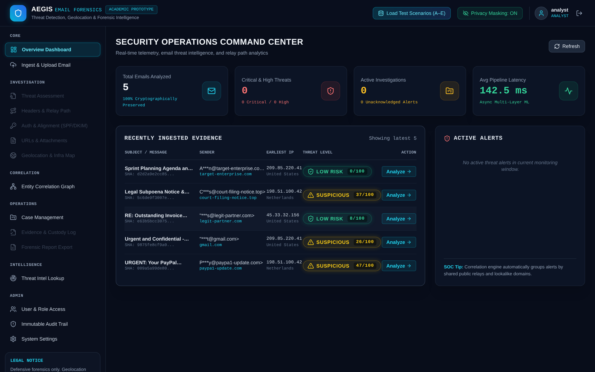
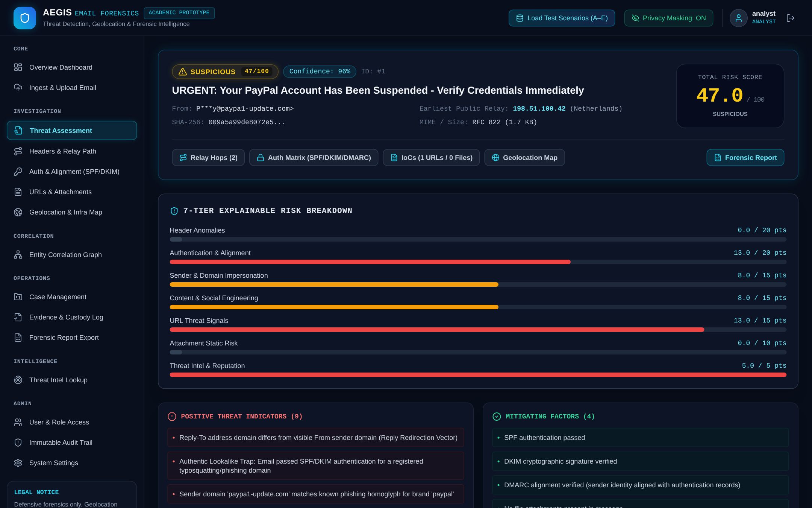
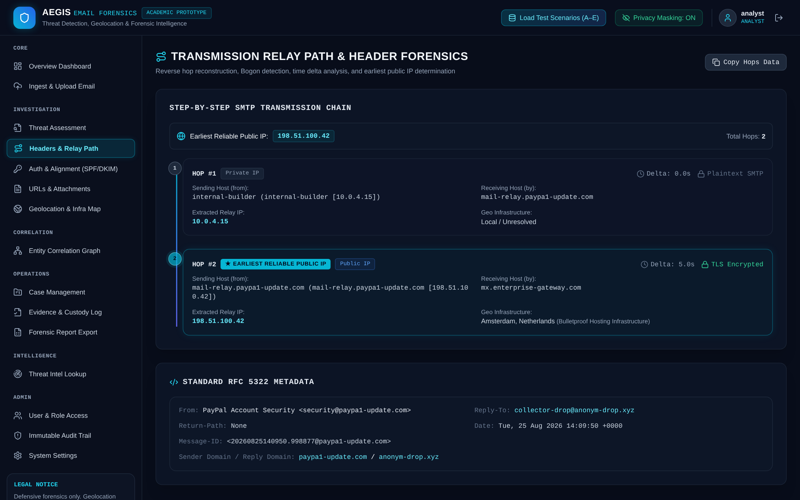
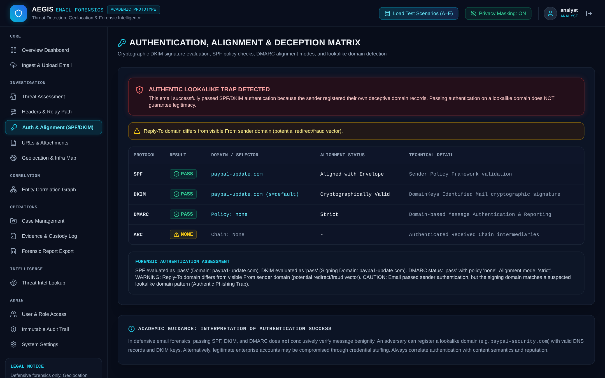
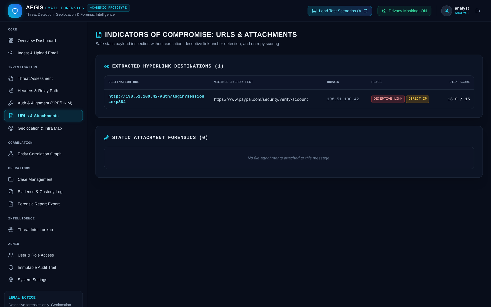
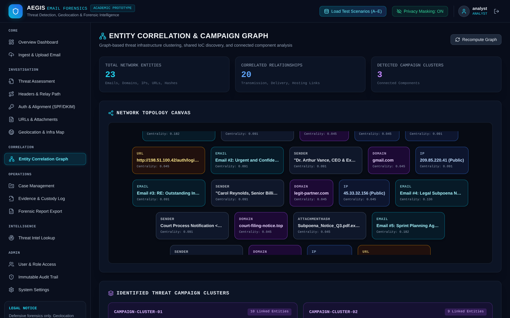
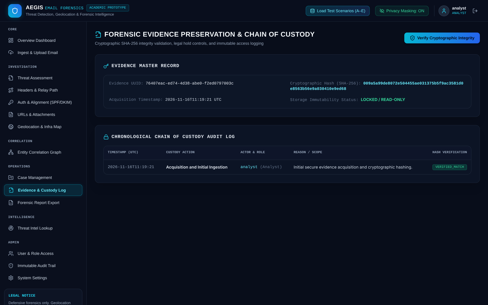
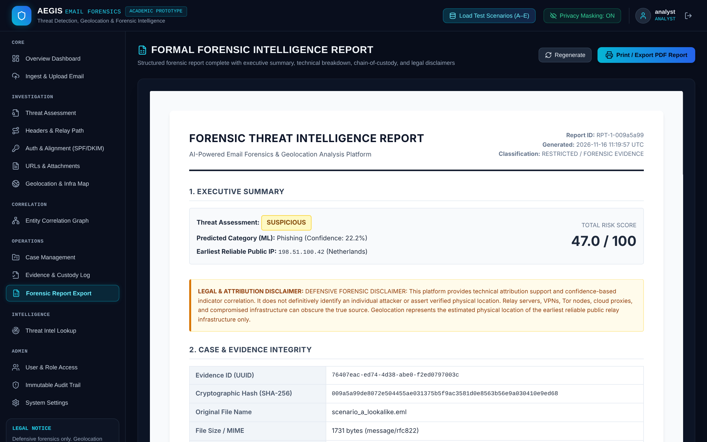
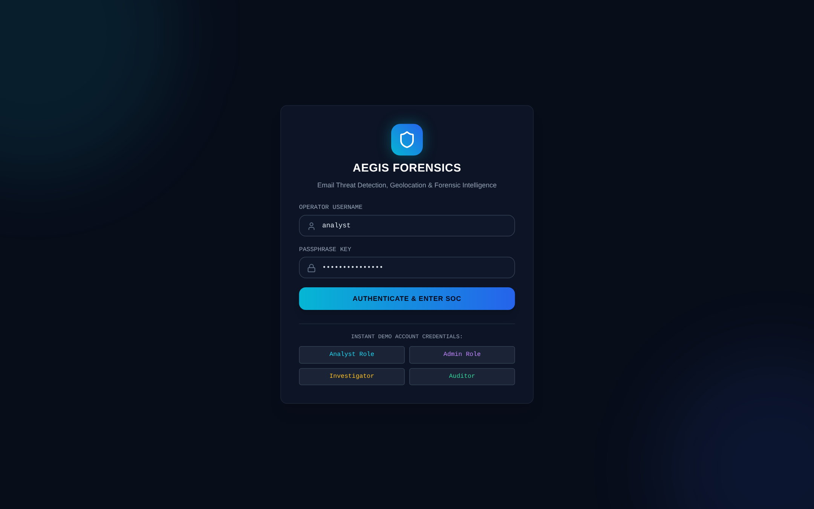

# AI-Powered Email Threat Detection, Geolocation and Forensic Intelligence Platform

An enterprise-grade academic prototype designed for deep email header forensics, relay hop reconstruction, earliest reliable public IP extraction, authentication validation (SPF, DKIM, DMARC, ARC), homoglyph/typosquatting detection, NLP social engineering classification, static payload inspection, infrastructure geolocation, explainable 7-tier risk scoring, entity graph correlation, and cryptographic chain-of-custody logging.

**▶ Live demo: [email-threat-detection-sih.vercel.app](https://email-threat-detection-sih.vercel.app)**. Click a demo role (e.g. *Analyst Role*), then **Authenticate & Enter SOC**. The five synthetic attack scenarios are already analysed, so every page has data. The demo database resets on its own.

Built by team TheInitiators26 for Smart India Hackathon (SIH).



---

## 📸 Screenshots

The screenshots show Scenario A (a lookalike-domain PayPal phishing email) going through the pipeline.

| | |
|---|---|
| **Threat assessment**: 7-tier explainable risk score with positive and mitigating evidence<br> | **Relay path & header forensics**: hop-by-hop SMTP reconstruction and the earliest reliable public IP<br> |
| **Authentication & deception matrix**: SPF / DKIM / DMARC / ARC alignment and "authentic lookalike" detection<br> | **URLs & attachments**: deceptive link detection and static attachment forensics<br> |
| **Entity correlation graph**: shared infrastructure grouped into campaign clusters<br> | **Chain of custody**: SHA-256 evidence record and immutable custody log<br> |
| **Forensic report**: printable intelligence report with PDF export<br> | **Login**: role-based access with one-click demo accounts<br> |

---

## 🌟 Key Platform Capabilities

- **Deep RFC 5322 Header & Relay Hop Reconstruction**: Parses `from`, `by`, `with`, `tls`, and timestamps across intermediate hops; detects impossible clock skews, duplicate hops, and bogon IPs; isolates the *Earliest Reliable Public IP*.
- **Authentication Deception & Alignment Engine**: Evaluates SPF, DKIM, DMARC policies and strict/relaxed alignments; uncovers *Authentic Lookalike Traps* where attackers authenticate their own phishing domains.
- **Homoglyph & Brand Typosquatting Analyzer**: Levenshtein distance, Jaro-Winkler similarity, Unicode/Punycode (`xn--`) detection, and target brand keyword matching.
- **Content NLP & Social Engineering Heuristics**: Scans subject and body text/HTML for urgency cues, fear/authority, wire transfer changes, and credential harvesting.
- **Calibrated Machine Learning Classifier**: TF-IDF (word & char n-grams) + calibrated Logistic Regression model returning predicted class probabilities and top contributing feature tokens.
- **Static URL & Attachment Forensics**: Inspects deceptive link anchors (`<a href="evil">legit</a>`), shorteners, IP URLs, double extensions (`.pdf.exe`), and macro signatures (`.docm`, VBA).
- **Explainable 7-Tier Risk Scoring (0–100)**: Transparent scoring across headers, authentication, sender identity, content NLP, URLs, attachments, and threat intelligence.
- **NetworkX Graph Correlation**: Entity relationship graph modeling connected components, shared infrastructure clusters, and degree centrality.
- **Cryptographic Evidence Preservation & Chain of Custody**: Immutable raw `.eml` storage, SHA-256 integrity verification, and chronological action auditing.
- **Interactive Analyst Dashboard (React + TypeScript + Tailwind + Leaflet)**: 15 integrated views, dark cybersecurity aesthetic, real-time relay map, and one-click forensic report exports.
- **5 Synthetic Demonstration Scenarios (A–E)**: Packaged tests covering lookalike phishing, CEO gift card fraud, BEC with valid auth, malicious attachments, and clean legitimate emails.

---

## 🛡️ Attribution Disclaimer

> [!IMPORTANT]
> **DEFENSIVE FORENSIC LIMITATION NOTICE:**
> This platform provides technical attribution support and confidence-based indicator correlation. It does **not** claim to definitively identify an individual attacker or assert verified physical location. Relay servers, VPNs, Tor nodes, cloud proxies, and compromised infrastructure can obscure the true source. Geolocation represents the estimated physical location of the earliest reliable public relay infrastructure only.

---

## 🚀 Quick Start & Installation

### Option A: Local Execution (Fastest)

#### 1. Backend Setup (Python 3.10+)
```bash
cd backend
python -m pip install -r requirements.txt
python -m app.ml.train
python -m uvicorn app.main:app --port 8000 --reload
```
API Documentation available at: `http://localhost:8000/docs`

#### 2. Frontend Setup (Node.js 18+)
```bash
cd frontend
npm.cmd install
npm.cmd run dev
```
Access the Dashboard at: `http://localhost:5173`

---

### Option B: Docker Compose Deployment
```bash
docker compose up --build
```
Access the Dashboard at: `http://localhost`

---

## 👤 Default User Accounts (RBAC)

| Role | Username | Password | Access Capabilities |
| :--- | :--- | :--- | :--- |
| **Analyst** | `analyst` | `AnalystPass123!` | Ingestion, threat scoring, case updates, report export |
| **Administrator** | `admin` | `AdminPass123!` | Threshold configuration, user directory, audit logs |
| **Investigator** | `investigator` | `InvestigatorPass123!` | Case timeline reviews, graph correlation, report generation |
| **Auditor** | `auditor` | `AuditorPass123!` | Read-only audit logs & SHA-256 cryptographic verification |

---

## 🧪 Testing

Run backend unit, integration, and security test suite:
```bash
cd backend
python -m pytest tests/ -v
```

---

## 📚 Academic Documentation Directory

Detailed architectural and forensic specifications are available in the [`docs/`](file:///c:/Users/kavyy/Downloads/Email%20threat/docs) folder:
- [System Architecture & Data Flow](file:///c:/Users/kavyy/Downloads/Email%20threat/docs/ARCHITECTURE.md)
- [Entity-Relationship Diagram & Database Schemas](file:///c:/Users/kavyy/Downloads/Email%20threat/docs/ER_DIAGRAM.md)
- [REST API Specification](file:///c:/Users/kavyy/Downloads/Email%20threat/docs/API_SPEC.md)
- [Security & Privacy Controls](file:///c:/Users/kavyy/Downloads/Email%20threat/docs/SECURITY_PRIVACY.md)
- [Attribution Limitations & Legal Disclaimers](file:///c:/Users/kavyy/Downloads/Email%20threat/docs/LIMITATIONS_DISCLAIMER.md)
- [Demonstration Script for Scenarios A–E](file:///c:/Users/kavyy/Downloads/Email%20threat/docs/DEMONSTRATION_GUIDE.md)
