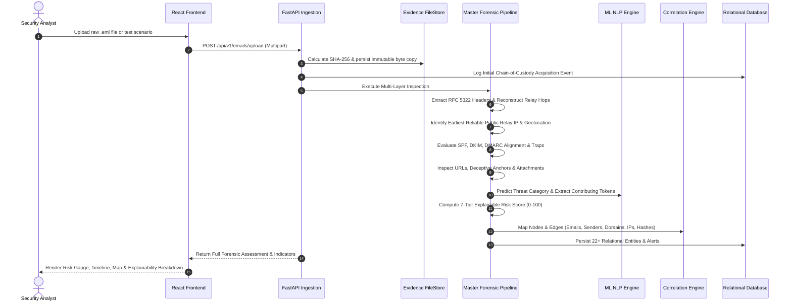
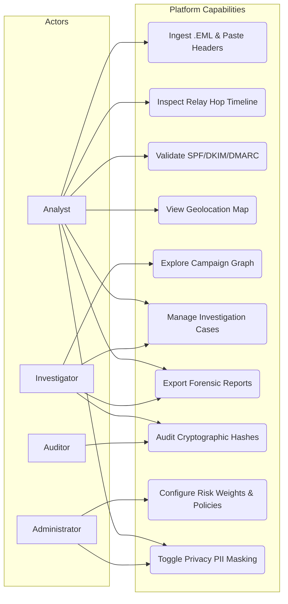

# System Architecture & Data-Flow Specification

## 1. System Architecture Overview

The **AI-Powered Email Threat Detection, Geolocation and Forensic Intelligence Platform** is constructed as a high-throughput, modular cybersecurity monolith. It provides end-to-end evidence preservation, RFC 5322 header reconstruction, multi-vector authentication analysis, NLP social engineering detection, static payload inspection, infrastructure geolocation, explainable 7-tier risk scoring, and entity correlation.

```mermaid
graph TD
    User([Security Analyst / Investigator / Admin / Auditor]) -->|HTTPS / REST API| Frontend[React + TypeScript Dashboard]
    Frontend -->|JWT Auth / Reverse Proxy| API[FastAPI Backend Gateway]

    subgraph Core Ingestion & Preservation
        API --> IngestionService[Ingestion & Evidence Service]
        IngestionService --> Storage[Immutable Evidence Storage (.eml / SHA-256)]
        IngestionService --> Custody[Chain of Custody Logger]
    end

    subgraph Forensic Inspection Engine
        API --> Parser[RFC 5322 Header & Relay Hop Parser]
        Parser --> IPClassifier[IP Bogon & Public Classifier]
        Parser --> EarliestIP[Earliest Public IP Resolver]
        
        API --> AuthEngine[SPF, DKIM, DMARC & ARC Engine]
        AuthEngine --> LookalikeDetector[Lookalike Authentication Trap Resolver]
        
        API --> DomainEngine[Levenshtein, Jaro-Winkler & Homoglyph Engine]
        API --> ContentNLP[Content NLP & Social Engineering Heuristics]
        API --> URLAnalyzer[URL Deceptive Anchor & Entropy Inspector]
        API --> AttachmentAnalyzer[Static Magic Byte & Macro Inspector]
    end

    subgraph Intelligence & Scoring
        EarliestIP --> GeoEnrichment[Geolocation & ASN Enrichment Service]
        Parser --> ThreatIntel[Threat Intel Feeds: AbuseIPDB, VirusTotal, URLhaus]
        ContentNLP --> MLEngine[Calibrated ML Model: TF-IDF + Logistic Regression]
        
        ForensicResults[Multi-Layer Forensic Signals] --> RiskEngine[7-Tier Explainable Risk Engine 0-100]
    end

    subgraph Correlation & Storage
        RiskEngine --> DB[(Relational DB: PostgreSQL / SQLite)]
        RiskEngine --> GraphEngine[NetworkX Entity Correlation Engine]
        GraphEngine --> GraphDB[Campaign Clusters & Centrality Repo]
        RiskEngine --> ReportEngine[Forensic HTML / PDF Report Generator]
    end
```

---

## 2. End-to-End Forensic Data-Flow Diagram



---

## 3. Use-Case Diagram


