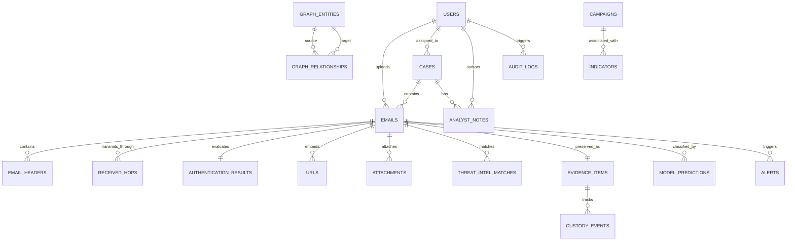

# Entity-Relationship Diagram & Database Schema

## 1. Entity-Relationship Diagram

---

## 2. Core Relational Schema Table Definitions

### 1. `users`
- `id` (INT, PK): Unique user identifier.
- `username` (VARCHAR(100), UNIQUE, INDEX): Login credential.
- `email` (VARCHAR(255), UNIQUE, INDEX): Registered email address.
- `hashed_password` (VARCHAR(255)): Argon2 / bcrypt password hash.
- `role` (VARCHAR(50)): Role assignment (`Analyst`, `Administrator`, `Investigator`, `Auditor`).
- `is_active` (BOOLEAN): Account activation status.
- `created_at`, `updated_at` (TIMESTAMPTZ): Audit timestamps.

### 2. `cases`
- `id` (INT, PK): Unique case ID.
- `case_number` (VARCHAR(50), UNIQUE, INDEX): Formal identifier (e.g. `CASE-9A1F4C20`).
- `title` (VARCHAR(255)): Incident title.
- `description` (TEXT): Scope and summary.
- `severity` (VARCHAR(50)): `Low`, `Medium`, `High`, `Critical`.
- `status` (VARCHAR(50)): `New`, `Under investigation`, `Contained`, `Escalated`, `Resolved`, `Closed`, `False positive`.
- `assigned_analyst_id` (INT, FK -> users.id).

### 3. `emails`
- `id` (INT, PK): Unique email ID.
- `sha256_hash` (VARCHAR(64), UNIQUE, INDEX): Cryptographic digest of immutable original byte payload.
- `original_filename` (VARCHAR(255)): Ingestion filename.
- `file_size` (INT): Byte length.
- `raw_subject`, `raw_from`, `raw_to`, `raw_reply_to`, `raw_return_path` (TEXT).
- `sender_domain`, `reply_to_domain` (VARCHAR(255), INDEX).
- `sanitized_body_text`, `sanitized_body_html` (TEXT): Sanitized representations.
- `earliest_public_ip` (VARCHAR(100), INDEX): Earliest reliable public hop IP.
- `total_risk_score` (FLOAT, INDEX): 0–100 composite threat score.
- `risk_classification` (VARCHAR(50), INDEX): `Low risk`, `Suspicious`, `High risk`, `Critical`.
- `confidence_score` (FLOAT): Calibrated confidence (0.0 to 1.0).
- `recommended_action` (TEXT): Prescribed operational response.

### 4. `received_hops`
- `id` (INT, PK).
- `email_id` (INT, FK -> emails.id).
- `hop_order` (INT): Chronological hop sequence (1 = earliest origin, N = gateway).
- `sending_server`, `receiving_server` (VARCHAR(255)).
- `extracted_ip` (VARCHAR(100), INDEX).
- `ip_classification` (VARCHAR(50)): `Public`, `Private`, `Loopback`, `Link-local`, `Bogon/Reserved`.
- `timestamp_utc` (TIMESTAMPTZ).
- `time_delta_seconds` (FLOAT): Inter-hop transit delay.
- `tls_status` (BOOLEAN), `tls_cipher` (VARCHAR(255)).
- `is_earliest_reliable_public_ip` (BOOLEAN).
- `geo_country`, `geo_city`, `geo_lat`, `geo_lon`, `asn_org` (VARCHAR/FLOAT).

### 5. `authentication_results`
- `id` (INT, PK).
- `email_id` (INT, FK -> emails.id).
- `spf_result`, `spf_domain`, `spf_scope` (VARCHAR).
- `dkim_result`, `dkim_domain`, `dkim_selector`, `dkim_body_hash_valid` (VARCHAR/BOOLEAN).
- `dmarc_result`, `dmarc_policy`, `dmarc_alignment`, `dmarc_from_domain` (VARCHAR).
- `arc_present`, `arc_result` (BOOLEAN/VARCHAR).
- `from_reply_to_aligned`, `is_lookalike_domain_auth` (BOOLEAN).
- `natural_language_explanation` (TEXT).

### 6. `urls`
- `id` (INT, PK).
- `email_id` (INT, FK -> emails.id).
- `raw_url` (TEXT), `display_text` (TEXT), `domain` (VARCHAR(255), INDEX).
- `is_ip_based`, `is_punycode`, `is_shortened`, `is_deceptive`, `has_suspicious_port` (BOOLEAN).
- `path_entropy` (FLOAT), `risk_score` (FLOAT), `risk_reasons_json` (TEXT).

### 7. `attachments`
- `id` (INT, PK).
- `email_id` (INT, FK -> emails.id).
- `filename`, `file_extension`, `declared_mime_type`, `magic_file_type` (VARCHAR).
- `file_size` (INT), `sha256_hash` (VARCHAR(64), INDEX), `md5_hash` (VARCHAR(32)).
- `has_double_extension`, `has_macros`, `is_script_or_executable`, `is_password_protected` (BOOLEAN).
- `risk_score` (FLOAT), `risk_reasons_json` (TEXT).

### 8. `evidence_items` & `custody_events`
- Immutable physical file metadata and chronological action ledger with pre/post SHA-256 validation.

### 9. `audit_logs`
- Non-repudiable audit records capturing `user_id`, `username`, `action`, `resource_type`, `resource_id`, `client_ip`, `user_agent`, and `timestamp_utc`.
